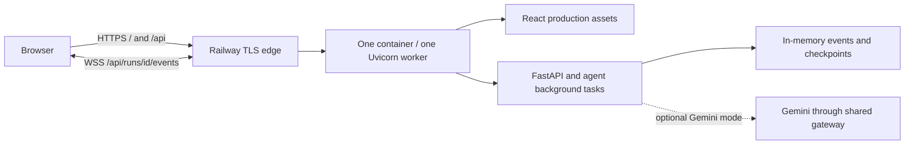

# Whack hosting plan

Status: demo implemented and deployed on 8 November 2026. The architecture and
remaining milestone 2 work below remain the implementation reference.

## Deployment record

- Live URL: https://whack-production.up.railway.app
- Branch: `deploy/railway-demo`; deployed code commit: `27f18fa`.
- Railway deployment: `c562faef-5853-4120-8ebd-5ee4ae6324e8`, status `SUCCESS`.
- One replica, one Uvicorn worker, 1 GB memory limit, fake LLM mode, no Gemini key.
- Uploaded through the authenticated Railway CLI. GitHub source attachment still
  returns "User does not have access to the repo"; branch pushes do not autodeploy.
- Validation: backend suite (300 passed, 8 skipped before the extra boundary test),
  four production tests, Ruff, 11 frontend tests, frontend build, development
  integration, local Docker smoke, and hosted Node 22 smoke passed. Hosted smoke
  covered HTTPS/assets, WSS, controls, redirects, cursor reconnect, and fake reports.
  Sixteen malformed/unknown HTTP cases plus WSS invalid cursors and replay passed.
- Observed hosted memory: approximately 0.2 GB after smoke testing. Usage endpoint
  still reported $0 immediately afterward; usage reporting may lag.
- No upgrade or paid extras enabled. Railway rejected a $5 hard usage cap because
  the minimum configurable hard cap is $10; no usage cap was added. Monitor trial
  credit in Billing and stop the service when testing ends.
- Sessions remain ephemeral; one non-replay run can be active globally. No browser
  screenshot or manual UI review has been performed; the user will test the branch.
- `railway.toml` worked for this release. The CLI warns that this config format is
  supported until 1 December 2026; migrate to Railway's infrastructure-as-code
  format before relying on later deployments.

Prepared 8 November 2026 from the current checkout and the opening deployment
analysis in [the referenced task](thread://01a1b7e4-fc62-7573-86ca-d07bf045fe3f).

**Recommendation: deploy one Docker service on Railway Hobby, serving the React
build and FastAPI from the same domain.** Use one Uvicorn worker and one replica.
Keep Render's paid web service as the fallback using the same container.

The first release targets a presenter-led hackathon demo with synthetic results.
Independent public use and restart-safe research sessions are a second milestone.
This scope assumes a small hosting budget and accepts session loss on restart for
the demo. A requirement for durable sessions moves milestone 2 ahead of launch.

## 1. Options and decision

Provider details were checked against official documentation on 8 November 2026.
Recheck prices when provisioning; these are planning inputs, not a fixed quote.

| Option | Fit for Whack | Decision |
| --- | --- | --- |
| Railway Hobby, one Docker service | Persistent Python process, WebSockets, and one deployment. $5 monthly minimum with $5 usage included; excess usage costs extra. | First choice for the demo. |
| Render paid web service | Same container architecture and WebSocket support. The former Starter tier is now `0.5c-512mb` (512 MB); size from measured memory, not the lowest tier alone. | Fallback if Railway access or billing is inconvenient. Confirm current compute and workspace charges before launch. |
| Render Free | Sleeps after 15 minutes without inbound traffic; waking takes about a minute. Sleeping/restarting loses the current in-memory sessions. | Early previews only. |
| Vercel frontend + Railway/Render backend | Works with separate API and WebSocket base URLs, CORS/origin configuration, and two deployments. The current browser assumes one origin. | Defer until a separate frontend deployment has a concrete benefit. |
| Entire app on Vercel Functions | Vercel now documents FastAPI WebSockets, but connections end at function duration limits and reconnects can reach different instances. Current background runs and memory state require redesign. | Poor fit for the first release. |
| Google Cloud Run | Supports WebSockets, but requests have a maximum 60-minute timeout and affinity is best effort. Background CPU allocation and durable state also need deliberate configuration. | Consider later if GCP credits or team experience justify it. |

Sources: [Railway pricing](https://railway.com/pricing),
[Railway networking limits](https://docs.railway.com/networking/public-networking/specs-and-limits),
[Render compute plans](https://render.com/docs/compute-plans),
[Render pricing](https://render.com/pricing),
[Render WebSockets](https://render.com/docs/websocket),
[Render Free](https://render.com/docs/free),
[Vercel WebSockets](https://vercel.com/docs/functions/websockets), and
[Cloud Run WebSockets](https://docs.cloud.google.com/run/docs/triggering/websockets).

## 2. Current readiness

The repository now contains a working application; the documentation-only account
in `AGENTS.md` is outdated. Deployment work should follow the actual source.

| Area | Current state | Hosting consequence |
| --- | --- | --- |
| Frontend | Vite builds `frontend/dist/`; browser HTTP and WS URLs use `/api`. | Add production routing; Vite's development proxy will not exist in the container. |
| API | `backend/api/main.py` exposes unprefixed routes such as `/health` and `/runs`. | Mount the API at `/api` in a production entrypoint. |
| Agent | Default API connects `AgentService`; `LLM_MODE=fake` or `gemini` is supported. | The earlier `agent_unavailable` integration gap is resolved. Start with fake mode. |
| Research tools | API agent still constructs `StubTools` and `StubGate`. | Gemini enables model decisions, not validated NBA findings. Real-data integration is separate work. |
| Streaming | Cursor reconnect, backoff, heartbeat, and missing-session recovery exist. | Verify these through the production entrypoint and the host's HTTPS/WSS edge. |
| State | `MemoryEventLog`, agent sessions, and LangGraph checkpoints are in memory. | One worker/replica; restart or deploy loses sessions and active work. |
| Concurrency | One active non-replay run globally; paused runs remain stored. | Presenter-led access for milestone 1; independent users need isolation. |
| Replay | `replays/mock.jsonl` is available; API can stream recordings. | Package the fixture. A recording launcher in the UI is optional follow-up work. |
| Reports and controls | Agent reports and pause/resume are integrated; redirect is demo-only; replay reports return 409. | Test supported flows and describe limitations accurately. |
| Dependencies | Frontend has `package-lock.json`; Python declarations are in `pyproject.toml`. Existing `requirements.txt` omits direct dependencies including `google-genai` and `langgraph`. | Build from the project metadata and generate a complete tested Linux dependency lock before release. |

Evidence: [API](backend/api/main.py), [agent adapter](backend/api/agent.py),
[event log](backend/events/memory.py), [agent checkpoints](backend/agent/graph.py),
[browser stream](frontend/src/stream.ts), [Vite config](frontend/vite.config.ts), and
[integration test](frontend/tests/integration/proxy.test.mjs).

## 3. Target architecture



Use the host-provided domain initially. A custom domain is optional after smoke
tests pass. No database or volume is needed for the explicitly ephemeral demo;
adding a volume alone would not persist the current Python objects.

The proposed production module is `backend/api/production.py`:

- Mount the existing API at `/api`, before the frontend routes.
- Serve the built assets at `/`; restrict any SPA fallback to frontend GET/HEAD
  navigation. Unknown API paths and missing asset files must return errors, not HTML.
- Explicitly forward startup/shutdown lifespan to the mounted API so agent, demo,
  and replay tasks are closed correctly. Verify this rather than assuming mounted
  sub-applications inherit lifespan handling.
- Fail startup if the frontend build is absent. Keep `/api/health` inexpensive and
  independent of Gemini so health probes never spend tokens.
- Preserve the existing development entrypoint and Vite workflow.

No public event-schema changes are expected for milestone 1. Coordinate any later
contract changes across Python and generated TypeScript.

## 4. Milestone 1: hosted demo

Ownership follows [plan.md section 7.1](plan.md#71-role-addendum-a--data-and-stats-b--agent-c--product):
C owns product/API/deployment, B owns the agent/gateway, and A owns data/stats.

| Step | Owner | Deliverable and completion condition |
| --- | --- | --- |
| 1. Production routing | C | Add `backend/api/production.py` and focused backend tests. UI assets, prefixed HTTP/WS routes, error responses, and shutdown all work without Vite. |
| 2. Reproducible container | C, with B on dependencies | Add root `Dockerfile`, `.dockerignore`, and a complete Python runtime lock. Build succeeds in a clean Linux environment and imports all API/agent dependencies. |
| 3. Production integration checks | C + B | Test the built container, including stream recovery and fake-agent completion. Keep existing development-proxy coverage. |
| 4. Railway configuration | C | Add `railway.toml` for Docker build, healthcheck, and bounded restart policy; configure one replica and disable sleeping. Document settings not represented in the file. |
| 5. Hosted rehearsal | C + B | Deploy the tested commit in fake mode, run the acceptance checklist, record resource usage, and rehearse recovery. |
| 6. Optional Gemini rehearsal | B; A verifies result labels | Set server-side model/key, run one bounded controlled session, verify gateway behavior and synthetic-result labeling. Keep Scripted demo available. |
| 7. Release handoff | C | Record URL, commit/image reference, operator, configuration, resource observations, and rollback steps in README. Freeze deploys during presentation. |

### Container specification

- Multi-stage build: a pinned supported Node image builds the frontend with
  `npm ci` and `npm run build`; a pinned Python 3.12 slim image runs the app.
- Copy frontend build inputs including `contracts/` where required by TypeScript
  imports; use repository root as the build context.
- Install the Python package with its complete locked runtime dependencies. Do
  not treat the current `requirements.txt` as a complete deployable lock.
- Preserve the runtime paths for `backend/`, `contracts/`, `replays/mock.jsonl`,
  and `frontend/dist/`. Include only reviewed replay fixtures.
- Exclude `.env`, local environments, `.git`, `node_modules`, caches, and raw or
  generated data from the build context. Provide keys only at runtime.
- Run as a non-root user. Use an entrypoint that expands `PORT` and uses `exec`
  to forward shutdown signals. Its effective Linux command is:

```sh
exec python -m uvicorn backend.api.production:app --host 0.0.0.0 --port "${PORT:-8000}" --workers 1
```

This module and command are planned, not available yet. Do not use `--reload`,
Vite dev/preview, or multiple Uvicorn workers in the deployed service.

### Hosting configuration

| Setting | Initial value / policy |
| --- | --- |
| Service | One Docker web service, repository root build context |
| Plan | Railway Hobby if a single developer workspace fits; verify collaboration needs before choosing a paid workspace |
| Region | Closest practical region to the demo audience |
| Replica count | 1; no horizontal autoscaling |
| Sleeping | Disabled |
| Port | Host-injected `PORT`, bound on `0.0.0.0` |
| Healthcheck | `/api/health`, expect HTTP 200 and `{"status":"ok"}` |
| LLM | `LLM_MODE=fake` initially; no API key needed |
| Optional Gemini | `LLM_MODE=gemini`, `GEMINI_API_KEY`, a verified `GEMINI_MODEL`, and `GEMINI_RPM=5` initially |
| Logs | stdout/stderr with run IDs and error types; no keys or raw credential-bearing requests |
| Release control | Deploy only tested commits; stop automatic changes during rehearsal/presentation |
| Storage | Ephemeral for milestone 1; explicitly disclose session loss |

Follow [Railway's Dockerfile guidance](https://docs.railway.com/builds/dockerfiles),
[healthcheck guidance](https://docs.railway.com/deployments/healthchecks), and
[sleeping settings](https://docs.railway.com/deployments/serverless).
Railway's deployment healthcheck is not continuous monitoring; add an external
uptime check for `/api/health` when the demo stays online beyond rehearsal.

Budget for usage above Railway's $5 minimum, plus any Gemini usage separately.
Measure idle memory and peak memory/CPU during a complete run before setting
resource limits. Keep memory headroom and configure billing alerts; do not assume
an alert prevents spending. Choose any hard usage cap with its outage behavior in
mind. Real datasets may substantially change the measured resource requirements.

### Validation and launch gate

Run existing checks from the repository root with development dependencies installed:

```powershell
.\.venv\Scripts\python -m pytest
.\.venv\Scripts\python -m ruff check .
npm --prefix frontend ci
npm --prefix frontend run test
npm --prefix frontend run build
npm --prefix frontend run test:integration
```

After the planned Dockerfile exists, build and run the production image locally:

```powershell
docker build -t whack:demo .
docker run --rm -p 8000:8000 -e PORT=8000 -e LLM_MODE=fake whack:demo
```

The existing integration test starts Vite, so passing it alone does not validate
production hosting. Add a container-targeted check and complete these checks on
the actual public URL before calling milestone 1 finished:

- [ ] `/` and production JS/CSS load; refresh works; `/api/health` returns JSON.
- [ ] Unknown `/api` routes and missing assets return errors without SPA HTML.
- [ ] Scripted demo streams over WSS; pause, resume, and redirect work.
- [ ] Non-demo fake agent completes; its report is available through the API.
- [ ] Disconnect/reconnect restores events from the cursor without duplicates;
  commands are not resent. A paused session retains a healthy idle connection.
- [ ] Two browsers demonstrate the expected global run conflict, with no promise
  of independent simultaneous research sessions.
- [ ] Restart removes server state; stale browser sessions recover with the
  existing explanation, and a new run can start.
- [ ] The bundled replay streams; its report endpoint retains the documented 409.
- [ ] Shutdown cancels background work cleanly. Full-run peak memory fits the
  chosen resource limit, and repeated rehearsals do not exhaust memory.
- [ ] No secret appears in assets, image build context, logs, or replay fixtures.
- [ ] A browser screenshot and the tested URL/commit are recorded for handoff.

## 5. Operating and recovering the demo

Before presentation, complete a full rehearsal, stop creating extra sessions, and
freeze deployments. Keep a tested local checkout and Scripted demo ready. Save
important recordings explicitly; API memory is not an append-only durable archive.

Redeploys may temporarily overlap old and new processes even with one configured
replica. Their memory is separate, and WebSockets may remain on the old process.
Deploy only between demos; finish runs first and expect browsers to start fresh
sessions afterward. Healthcheck success does not imply session continuity.

If a release fails, restore the last tested deployment/image and its compatible
environment settings, then repeat health, asset, and WSS checks. Rollback restores
code, not lost sessions. A failed Gemini rehearsal can use Scripted demo immediately;
changing server LLM configuration may restart the process and should happen between
sessions. If hosting remains unavailable, use the rehearsed local demo.

For the Render fallback, deploy the same Dockerfile as one paid web service,
listen on its supplied `PORT`, set `/api/health`, and use the same variables and
acceptance checklist. Select memory from the rehearsal measurements. Preserve
one worker/instance and the same restart expectations.

## 6. Milestone 2: independent users and durable research

Complete this milestone before advertising durable sessions or inviting unrelated
users to run paid research independently. The current API has no user ownership
enforcement and retains sessions/events indefinitely in memory.

| Work | Owner | Acceptance condition |
| --- | --- | --- |
| Access and ownership | C | Authenticate HTTP and WS connections; authorize reads and interventions against run ownership; validate browser WS origins. One user cannot read or control another's run. |
| Concurrency and budgets | C + B | Replace the global limit with per-user admission and a bounded total queue; enforce server-side call/test budgets and request/replay limits. Browser-supplied budgets cannot override server caps. |
| Durable evidence | C | Replace `MemoryEventLog` with transactional append-only storage preserving event sequence; rebuild graph projections and reports after restart. Add retention/export policy and restore tests. |
| Agent recovery | B + C | Persist checkpoints and run metadata. Initially mark interrupted runs explicitly; resume only after testing recovery of approvals, tool side effects, and sealed-holdout access. Evidence persistence alone is not resumability. |
| Real NBA tools | A + B | Wire deterministic tools/gates into the API agent, package/version required data, and pass statistical integrity checks. Preserve gate authority over model judgments. |
| Operations | C | Automated release checks, external health monitoring, error/resource alerts, backups, and a tested restore procedure. |

For a durable single-instance pilot, SQLite on a persistent volume is a reasonable
first implementation, provided writes, event ordering, checkpoints, and backups are
designed together. Verify the host's volume/redeployment behavior before adopting it.
For multiple replicas, use shared database storage plus coordinated job execution
and event distribution; adding workers to the current process is not sufficient.

## 7. Completion criteria and choices to revisit

Milestone 1 is complete when a tested commit is reachable over HTTPS/WSS, the
hosted acceptance checklist passes, operating costs have been observed, and an
operator can recover using the documented steps. Live Gemini and validated NBA
research are separate capabilities with their own acceptance gates.

Proceed with the proposed defaults when implementation begins. Revisit the plan
if the audience needs independent access, sessions must survive deployment, a
strict monthly budget rules out usage billing, or existing hosting credits favor
another provider. Account ownership and billing are provisioning inputs; a custom
domain can follow the first successful deployment.
